<p align="center">
  
</p>

<p align="center">
  
</p>

<h1 align="center">Mayalok</h1>

<p align="center"><em>Formerly Namma Space.</em></p>

<p align="center">
  <b>Turn a smartphone walkthrough into a photorealistic, searchable 3D digital twin of an indoor space, with obstacle-aware walking directions in the browser.</b>
</p>

<p align="center">
  <a href="https://mayalok.vercel.app"></a>
  <a href="LICENSE"></a>
  
  
  
</p>

Mayalok reconstructs a venue from ordinary phone video into a 3D Gaussian Splat (`.spz`), derives a walkable occupancy grid from it, and ships a React + Three.js viewer where you can walk around, search for places, and follow a routed path to them.

**Live demo:** <https://mayalok.vercel.app>

## Contents

[Features](#features) · [Screenshots](#screenshots) · [Architecture](#architecture) · [Quick start](#quick-start) · [Docker](#docker) · [Deploy on Vercel](#deploy-on-vercel) · [Scenes](#scenes) · [Repository layout](#repository-layout) · [Testing](#testing) · [Roadmap](#roadmap) · [Team](#team) · [Credits and licences](#credits-and-licences)

## Features

- **Smartphone-only capture.** No LiDAR or CAD. Metric scale comes from the phone-height SOP or printed ArUco markers.
- **Photorealistic splats.** Rendered with [Spark.js](https://github.com/sparkjsdev/spark) on Three.js.
- **Spatial indexing and POI tagging.** Places (rooms, items, amenities) are stored as 3D tags with optional floor-plan zone polygons. Admin mode (`?admin`) adds, edits and draws them, with JSON import/export.
- **Pathfinding.** A* over the occupancy grid in a Web Worker, with path smoothing, turn-by-turn instructions and automatic re-routing when you leave the route.
- **Search UI.** Fuzzy search (Fuse.js) over POIs; picking a result shows its card, a route, and an optional autopilot walk to the destination. Deep link with `?to=<poi id or name>`.
- **Minimap and scene switcher.** Top-down map with player, POIs and route; switch scenes from the top bar or with `?scene=<id>`.

## Screenshots

| | |
| :---: | :---: |
| 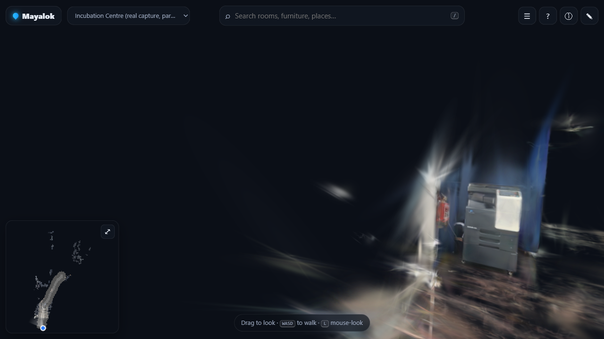<br>**Real capture.** The incubation centre scene, reconstructed from phone video. | 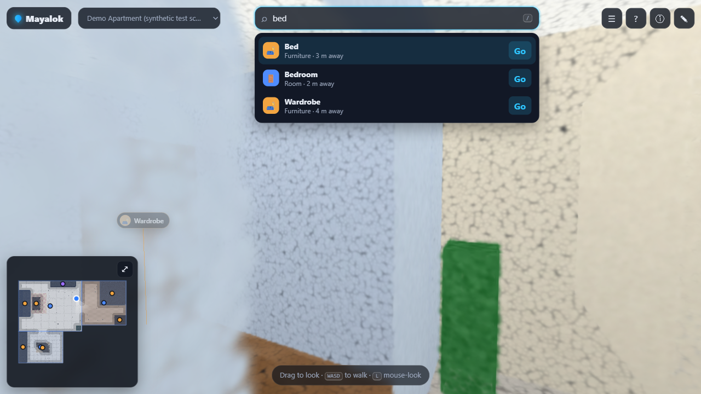<br>**Search.** Fuzzy search over tagged places. |
| 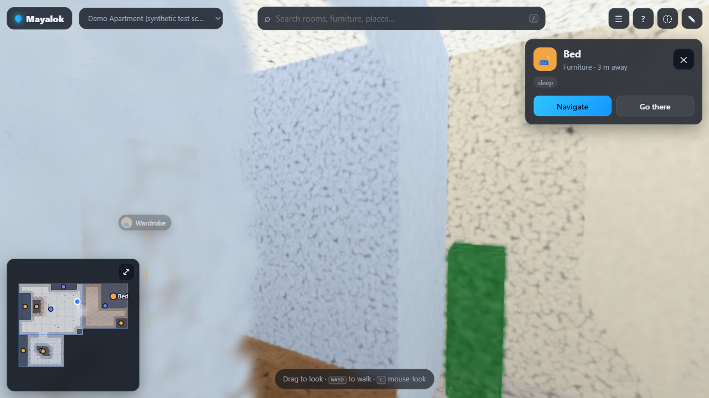<br>**POI card.** Click a place to see its details, then Navigate or jump there. | 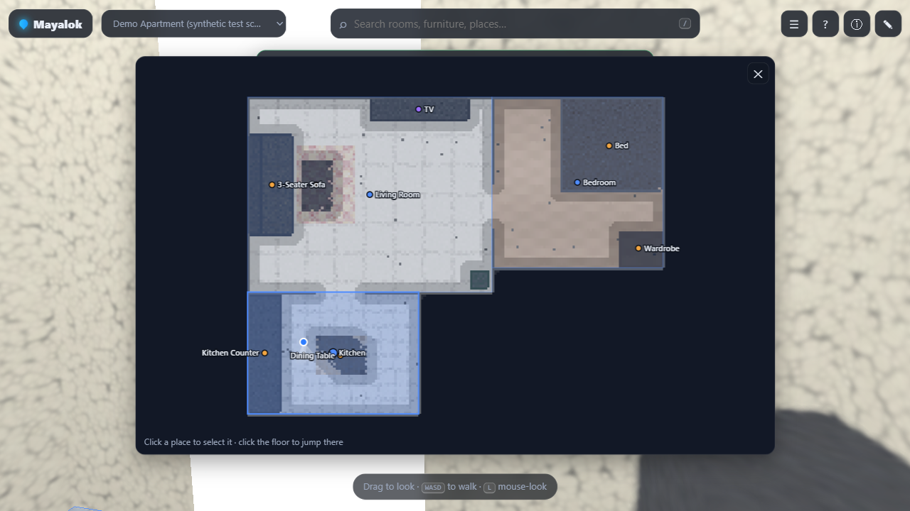<br>**Floor map.** Full top-down map with rooms, zones and tagged POIs. |
| 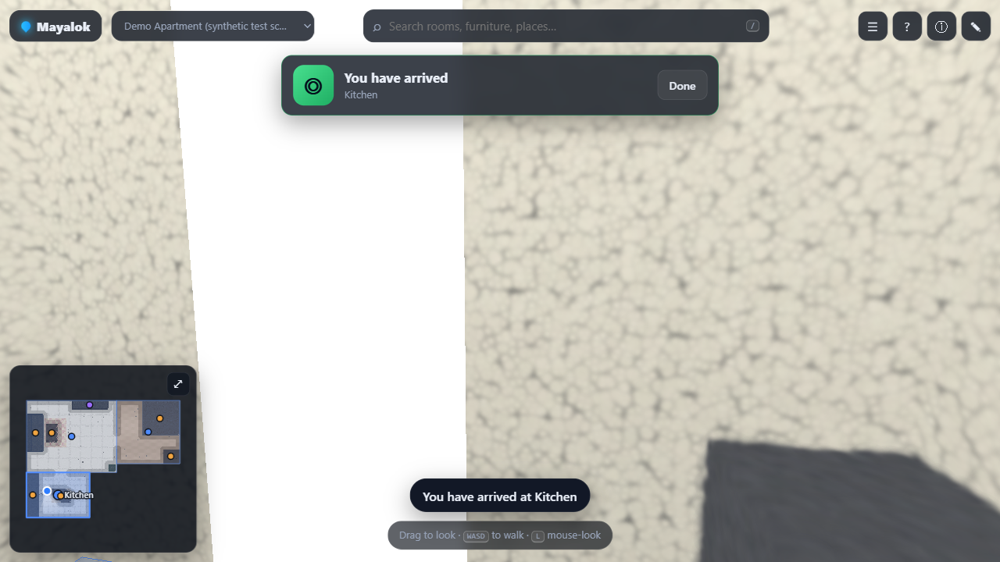<br>**Autopilot.** Hands-free walk along the route. | 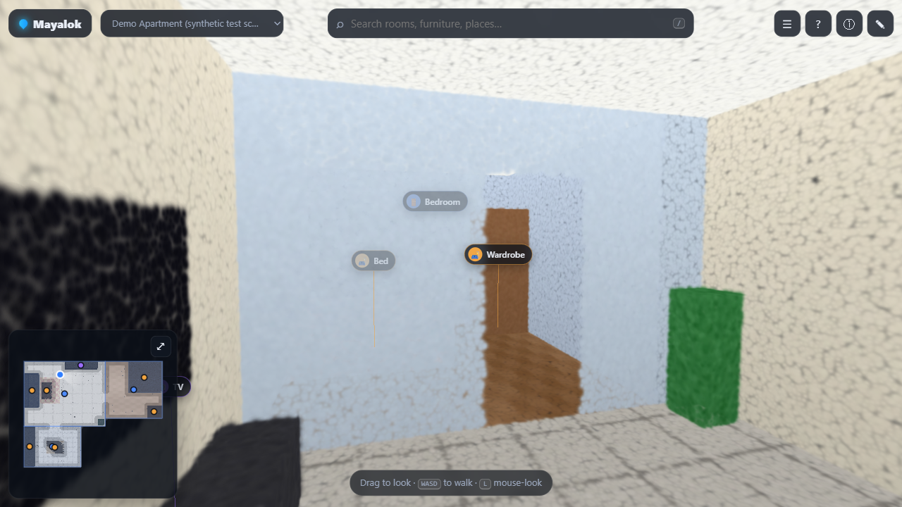<br>**Demo apartment.** Procedural three-room test scene. |

## Architecture

The pipeline runs offline in Python (resumable per stage). The viewer is a fully static site, with route search running in a Web Worker so the render loop never stalls.

[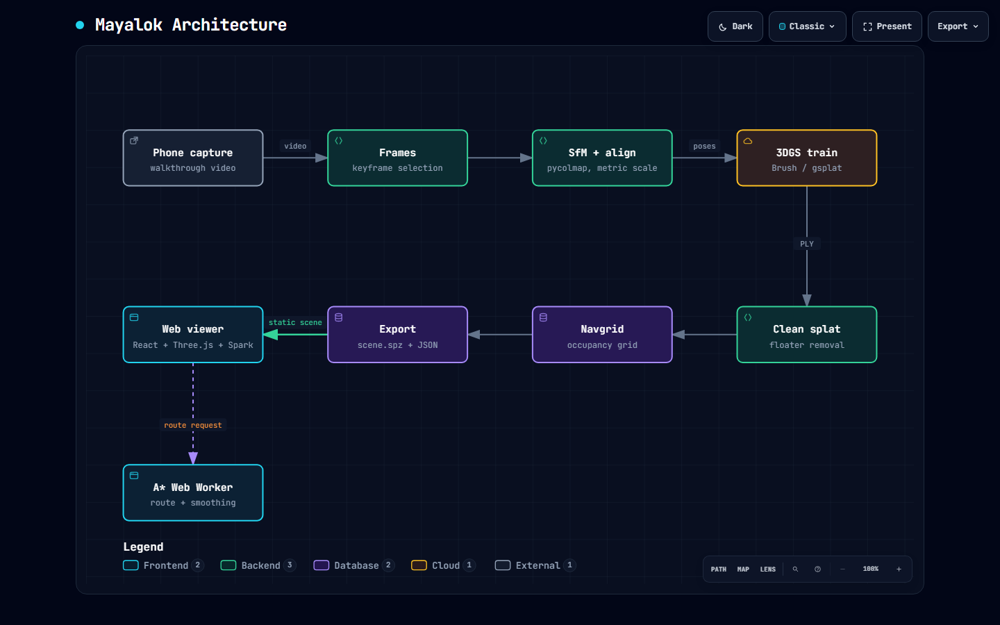](docs/architecture.html)

Interactive version: [`docs/architecture.html`](docs/architecture.html) (download and open in a browser; generated with Archify).

### Pipeline

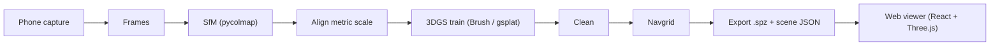

### Search to autopilot

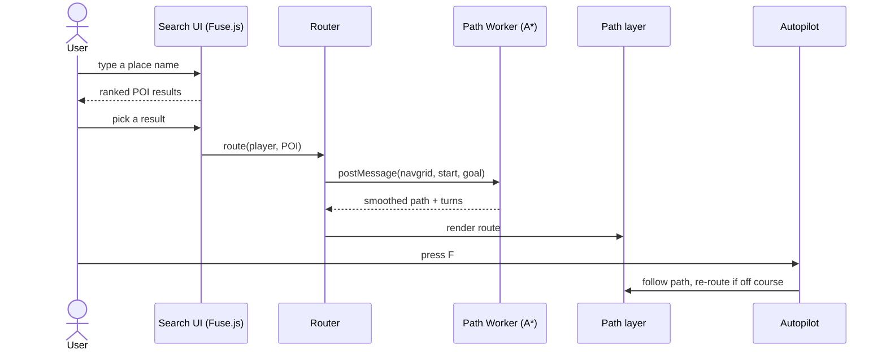

### Diagrams

| | |
| :---: | :---: |
| 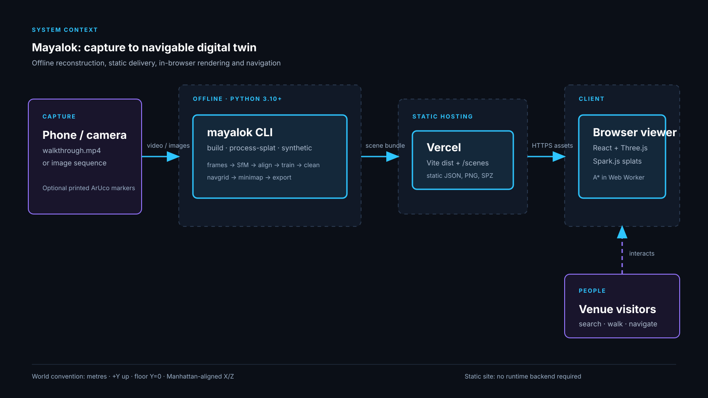<br>**System context** | 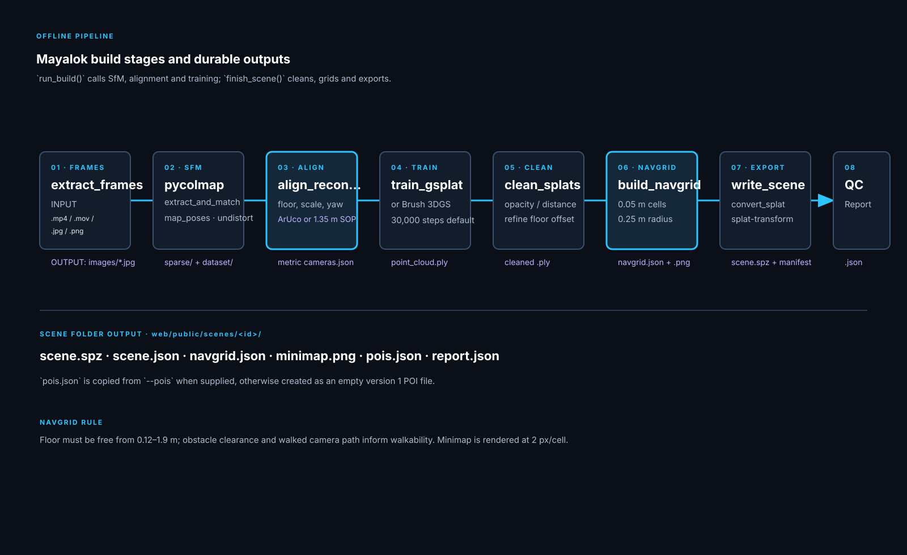<br>**Pipeline stages** |
| 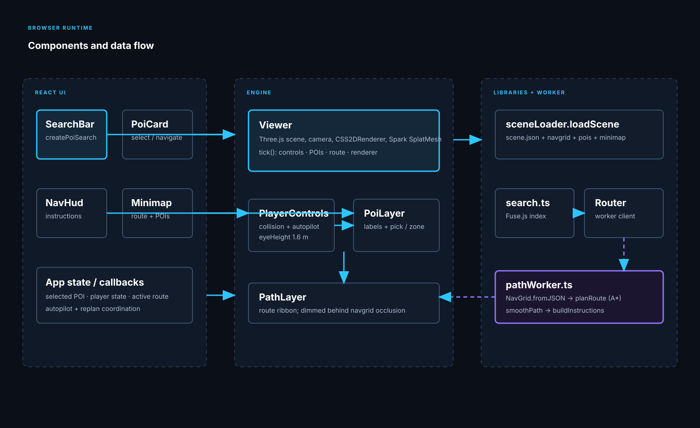<br>**Runtime components** | 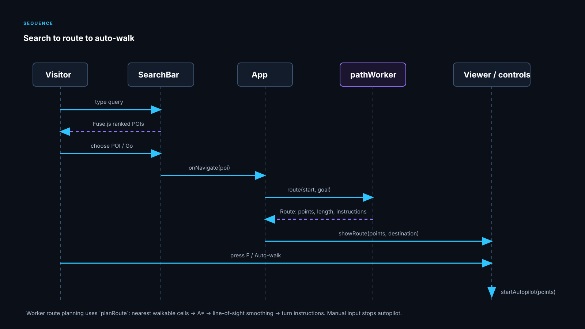<br>**Search to route to auto-walk** |
| 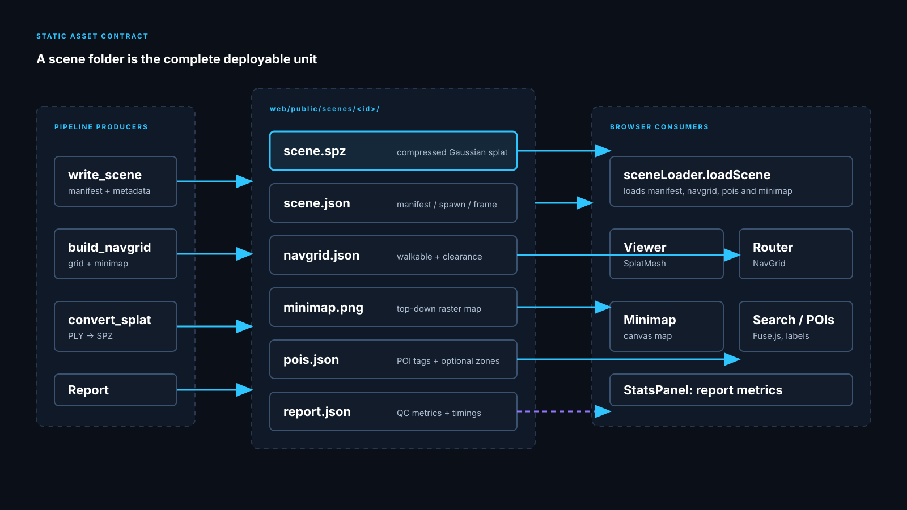<br>**Scene bundle contract** | 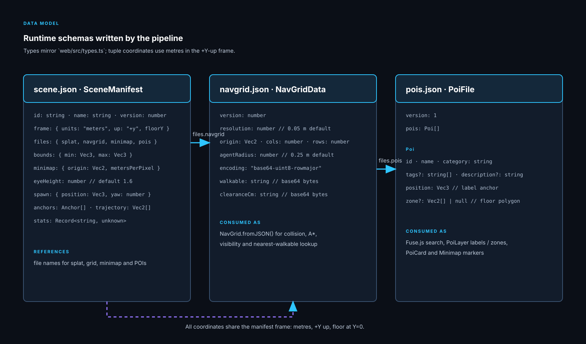<br>**Data model** |

## Quick start

### Web viewer

Requires Node 20+.

```bash
cd web
npm install
npm run dev        # http://localhost:5173
```

Controls: `WASD` walk, drag or `L` to look, `N` noclip, `G` route to selected place, `F` toggle autopilot, `X` stop, `M` expand map, `P` all places, `H` help. Add `?admin` to edit places and `?stats` for an FPS panel.

### Pipeline (Python)

Requires Python 3.10+ and [uv](https://docs.astral.sh/uv/).

Windows (PowerShell):

```powershell
cd pipeline
uv venv
.venv\Scripts\activate
uv pip install -e ".[test]"        # add ".[sfm]" for pycolmap
```

Linux / macOS:

```bash
cd pipeline
uv venv
source .venv/bin/activate
uv pip install -e ".[test]"        # add ".[sfm]" for pycolmap
```

Build a scene from video, or from an existing trained splat:

```bash
namma build --input walkthrough.mp4 --work ../work/venue --gsplat-dir /path/to/gsplat \
  --out ../web/public/scenes/my-venue --name "My Venue"

namma process-splat --splat point_cloud.ply --cameras cameras.json \
  --out ../web/public/scenes/my-venue --name "My Venue"

namma synthetic --out ../web/public/scenes/demo-apartment   # procedural test scene
```

PLY to `.spz` conversion uses `splat-transform` via npx (no global install):

```powershell
npx -y @playcanvas/splat-transform input.ply scene.spz
```

Then register the scene in `web/public/scenes/index.json`.

## Install as a package

The reconstruction pipeline ships as the `mayalok` Python package (CLI: `mayalok`).

```bash
pip install "mayalok[sfm]"        # once published to PyPI
# or straight from GitHub today:
pip install "git+https://github.com/The-Harsh-Vardhan/mayalok.git#subdirectory=pipeline"

mayalok process-splat --splat point_cloud.ply --cameras cameras.json --out web/public/scenes/my-venue --name "My Venue"
```

Docs site: https://the-harsh-vardhan.github.io/mayalok/

## Docker

Serve the production build with nginx (`.spz` is served as `application/octet-stream`):

```bash
docker compose up --build        # http://localhost:8080
```

Or without compose:

```bash
docker build -t mayalok-web ./web
docker run --rm -p 8080:80 mayalok-web
```

The image is multi-stage: `node:22-alpine` builds `web/` and `nginx:alpine` serves `dist`.

## Deploy on Vercel

Import the repo, then set **Root Directory** = `web` and **Framework Preset** = `Vite`. Build command `npm run build`, output directory `dist` (the defaults). Assets use relative paths (`base: "./"`), so no further config is needed.

## Scenes

| Scene | Description |
| --- | --- |
| `incubation` | Real smartphone capture of an incubation centre (24 Oct 2026), pycolmap SfM + Brush 3DGS. Partial: 65 of 293 keyframes registered. |
| `demo-apartment` | Procedurally generated three-room apartment for development and tests. |

Each scene folder in `web/public/scenes/<id>/` holds `scene.json`, `scene.spz`, `navgrid.json`, `minimap.png`, `pois.json` and `report.json`.

## Repository layout

```
pipeline/namma/    Python pipeline: frames, sfm, align, train, clean, navgrid, export, cli
pipeline/tests/    pytest suite
web/src/engine/    Viewer, player controls, POI and path layers
web/src/lib/       A*, router + path worker, geometry, scene loader, search
web/src/ui/        Search bar, POI card, nav HUD, minimap, admin tools
web/public/scenes/ Packaged scenes and index.json
web/Dockerfile     Multi-stage build (node -> nginx)
docker-compose.yml One-command local serve on :8080
docs/              SOP, technical abstract, briefs, architecture diagram, screenshots
```

## Testing

```bash
cd web && npm test && npm run build      # vitest (A*, turns, geometry) + typecheck + build
cd pipeline && pytest -m "not slow"
```

## Roadmap

- **AR navigation.** Localise a phone camera against the splat and overlay the route on the live camera feed, so the same twin guides you on site.

## Team

**Team QWERTY**

- Ajay Yadav (team leader)
- Hitesh Bhatiwal
- Harsh Vardhan

## Credits and licences

Code is MIT licensed (see [LICENSE](LICENSE)). Built on [Spark.js](https://github.com/sparkjsdev/spark) (MIT), [Three.js](https://threejs.org) (MIT), [React](https://react.dev) (MIT), [Fuse.js](https://www.fusejs.io) (Apache-2.0), [COLMAP](https://colmap.github.io)/pycolmap (BSD), [Brush](https://github.com/ArthurBrussee/brush) and [gsplat](https://github.com/nerfstudio-project/gsplat) (Apache-2.0), and [splat-transform](https://github.com/playcanvas/splat-transform) (MIT).
