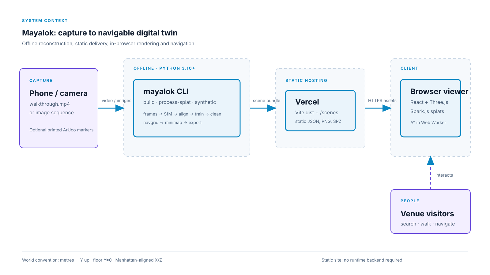
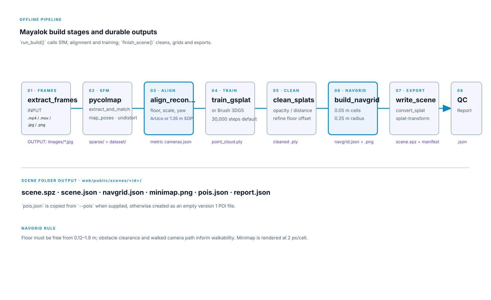
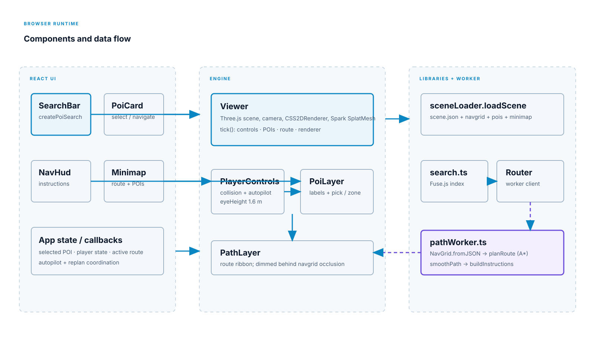
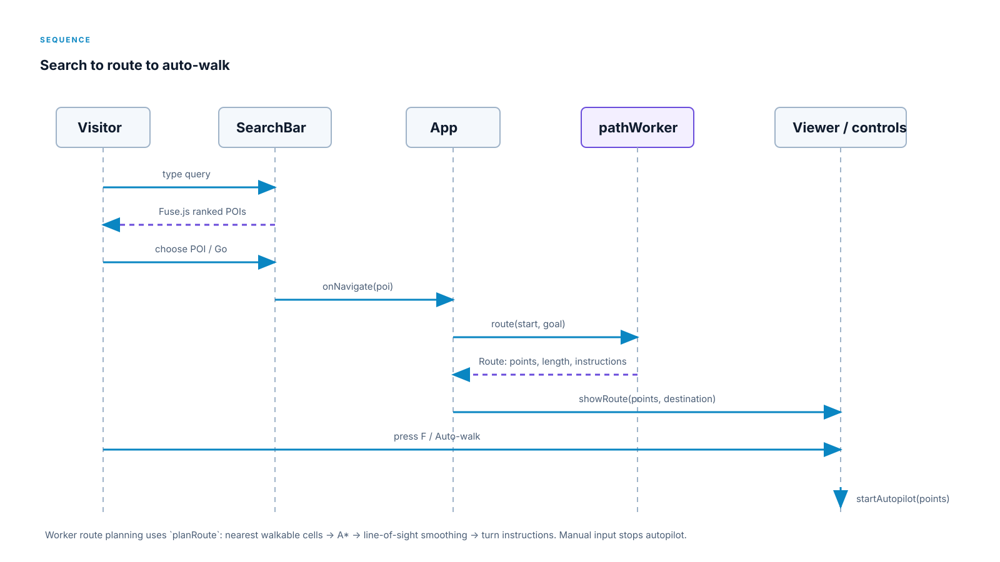
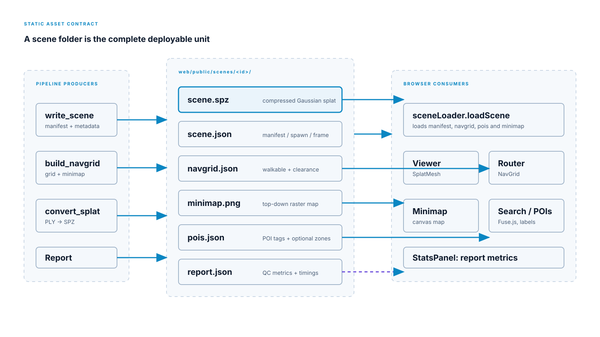
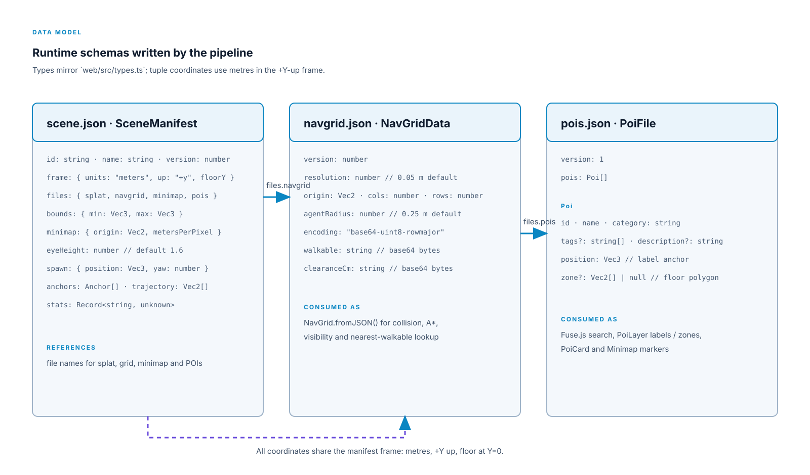

# Mayalok technical diagrams

Capture, offline processing, static hosting, browser runtime, and visitors.

The resumable reconstruction pipeline, including stage inputs and durable outputs.

React, renderer, UI, loader, routing worker, and navigation data flow.

The interaction from a POI search to route display and automatic walking.

The six files that make a static scene deployable and their producers and consumers.

The `scene.json`, `navgrid.json`, and `pois.json` schemas used at runtime.
