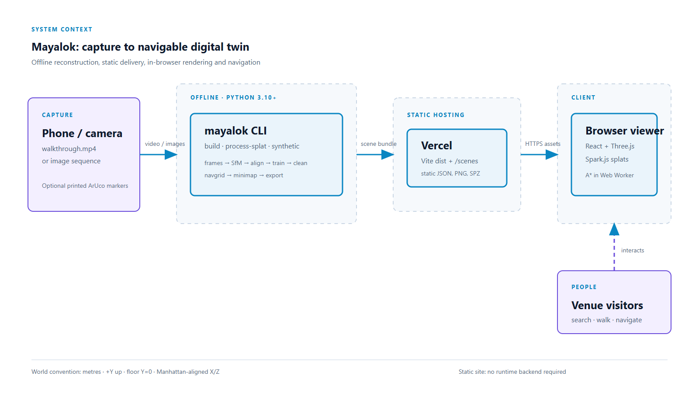
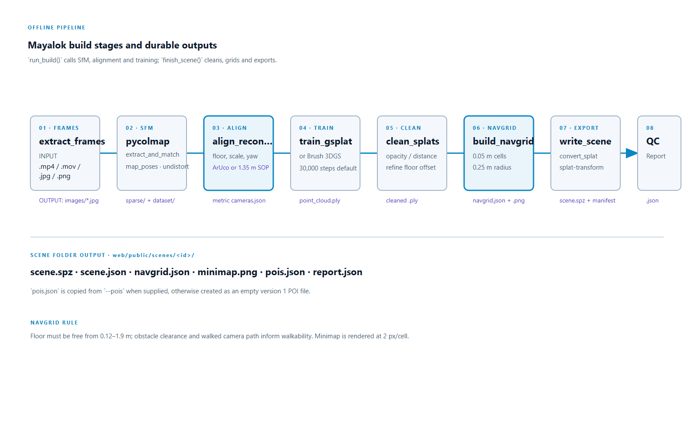
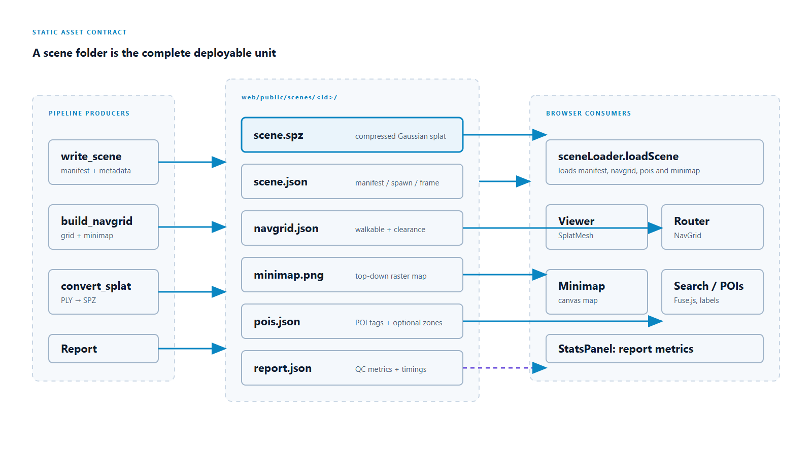
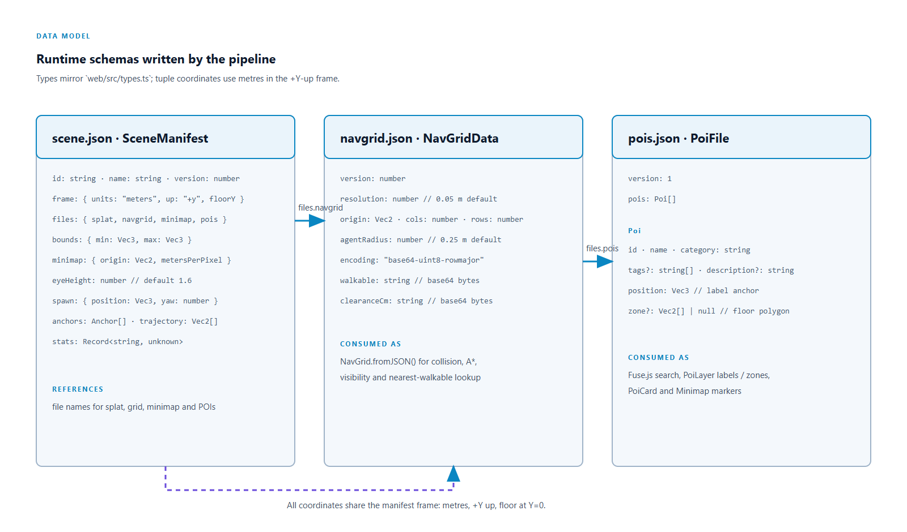

<p align="center">
  
</p>

# mayalok

**Turn ordinary smartphone video of an indoor space into a photorealistic, navigable 3D digital twin.**

`mayalok` is the reconstruction pipeline behind [Mayalok](https://mayalok.vercel.app): it takes a phone walkthrough
(video and/or photos) and produces a web-ready scene bundle — a compressed 3D Gaussian Splat (`.spz`), a walkable
occupancy grid for obstacle-aware pathfinding, a top-down minimap, POIs and a QC report — that the Mayalok browser
viewer loads for first-person walkthroughs, place search and turn-by-turn indoor navigation.

- **Live viewer:** https://mayalok.vercel.app
- **Docs:** https://the-harsh-vardhan.github.io/mayalok/
- **Source:** https://github.com/The-Harsh-Vardhan/mayalok

## Install

```bash
pip install "mayalok[sfm]"     # includes pycolmap for Structure-from-Motion
mayalok --help
```

The `.spz` export uses [`@playcanvas/splat-transform`](https://www.npmjs.com/package/@playcanvas/splat-transform)
(Node.js 18+; fetched automatically with `npx` if not installed). Training needs a 3DGS trainer such as
[gsplat](https://github.com/nerfstudio-project/gsplat) or [Brush](https://github.com/ArthurBrussee/brush).

## Usage

```bash
# Full pipeline from a walkthrough video
mayalok build --input walkthrough.mp4 --work ./work --out ./scenes/my-venue --name "My Venue"

# Package an already-trained splat for the web viewer
mayalok process-splat --splat point_cloud.ply --cameras cameras.json --out ./scenes/my-venue --name "My Venue"

# Procedural test apartment (no capture needed)
mayalok synthetic --out ./scenes/demo-apartment
```

## How it works



| Stage | What it does | Output |
|---|---|---|
| frames | sharpest-frame keyframe extraction (~2 fps) | `images/` |
| sfm | COLMAP / pycolmap features, sequential matching, mapping | `sparse/` |
| align | gravity + metric scale from ArUco markers or phone-height SOP | `cameras.json` |
| train | 3D Gaussian Splatting (gsplat; Brush fallback) | `point_cloud.ply` |
| clean | drop transparent/oversized/isolated splats, level floor | cleaned `.ply` |
| navgrid | 5 cm walkable occupancy grid + minimap | `navgrid.json`, `minimap.png` |
| export | compress splat, write manifest | `scene.spz`, `scene.json` |



### Scene bundle



### Data model




## MCP server

`mayalok` ships a [Model Context Protocol](https://modelcontextprotocol.io) server so AI agents can
explore scene bundles: `list_scenes`, `scene_info`, `find_places` (fuzzy POI search), `plan_route`
(A* over the navgrid with turn-by-turn directions), `process_splat` and `make_synthetic_scene`.

```bash
pip install "mayalok[mcp]"          # provides the `mayalok-mcp` command (stdio)

# Claude Code
claude mcp add mayalok -- uvx --from "mayalok[mcp]" mayalok-mcp

# or as a plugin
/plugin marketplace add The-Harsh-Vardhan/mayalok
/plugin install mayalok@mayalok
```

## Credits

Built by Team QWERTY (Ajay Yadav, Hitesh Bhatiwal, Harsh Vardhan) for the Techfest 2026-27 (IIT Bombay) Namma Space challenge.
Builds on 3D Gaussian Splatting (Kerbl et al., 2023), COLMAP, Three.js and Spark.js. MIT licence.

<!-- mcp-name: io.github.The-Harsh-Vardhan/mayalok -->
